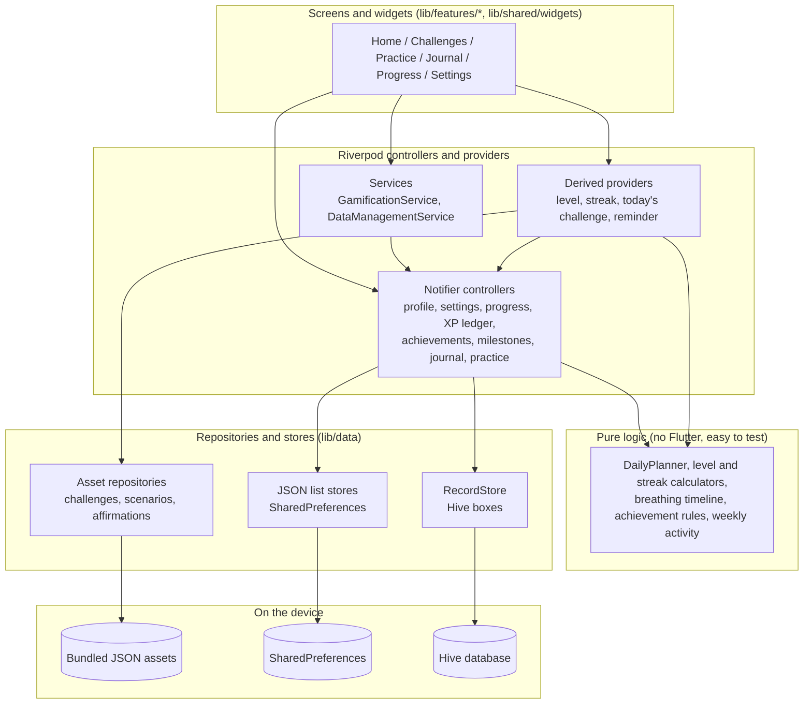
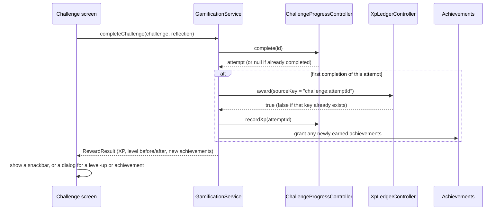

# Architecture

ConfidentMe is a local-first Flutter app. All logic runs on the device, all data
is stored on the device, and no part of it needs a server.

## The big picture



The rule that keeps this maintainable: **widgets show state and call methods;
they do not contain business rules or touch storage.** Rules live in small pure
Dart files and in controllers. Storage hides behind repositories and stores.

## Folder structure

```
lib/
  main.dart                  starts the app: opens storage, then runApp
  app.dart                   MaterialApp.router, theme, startup reconcile
  core/
    constants/               app_constants.dart (name, version, texts), xp_config.dart
    routing/                 app_router.dart (GoRouter, routes, redirects)
    theme/                   app_theme.dart, app_palette.dart (5 colour palettes)
    utils/                   clock.dart, greeting.dart, stable_hash.dart
  models/                    plain data classes with JSON (one file per model)
  data/
    providers.dart           providers for stores and repositories
    repositories/            storage code (see "Persistence")
  features/                  one folder per area of the app
    onboarding/  home/  challenges/  gamification/  breathing/
    social_practice/  practice/  affirmations/  journal/  progress/  settings/
    settings_controller.dart app-wide settings state
  shared/widgets/            small reusable widgets (SoftCard, InfoChip, dialogs)
assets/data/                 challenges.json, scenarios.json, affirmations.json
assets/icon/                 launcher icon artwork (not bundled into the app)
tool/make_icon.py            redraws the icon artwork (needs Pillow)
test/                        unit and widget tests (see "Testing")
integration_test/            end-to-end test for the main workflow
docs/                        this documentation
```

Why it differs a little from a textbook layout: there is no `data/local` and
`data/remote` split because there is no remote. `settings_controller.dart` sits
directly in `lib/features/` because every feature reads it. The `practice/`
folder is the hub screen plus the practice-session history; breathing and social
practice have their own folders.

## State management (Riverpod)

State is held in `Notifier` controllers (and `AutoDisposeNotifier` for
short-lived screens such as breathing and onboarding):

| Controller | File | Holds |
| --- | --- | --- |
| `ProfileController` | `lib/features/onboarding/profile_controller.dart` | the profile (null until onboarding is done or skipped) |
| `SettingsController` | `lib/features/settings_controller.dart` | theme, palette, difficulty, reminder, gamification switch |
| `ChallengeProgressController` | `lib/features/challenges/progress_controller.dart` | every challenge attempt |
| `XpLedgerController` | `lib/features/gamification/xp_ledger_controller.dart` | append-only XP history |
| `EarnedAchievementsController` | `lib/features/gamification/achievements_controller.dart` | achievements earned and when |
| `MilestonesController` | `lib/features/gamification/milestones_controller.dart` | personal milestones |
| `PracticeSessionsController` | `lib/features/practice/practice_sessions_controller.dart` | finished practice sessions |
| `JournalController` | `lib/features/journal/journal_controller.dart` | journal entries |
| `BreathingController` | `lib/features/breathing/breathing_controller.dart` | one breathing session |
| `OnboardingController` | `lib/features/onboarding/onboarding_controller.dart` | answers while you fill them in |

Read-only values are **derived providers** that recompute when what they depend
on changes, for example `levelInfoProvider`, `streakProvider`,
`todaysChallengeProvider`, `reminderVisibleProvider` and
`exploredCategoriesProvider`. Because they are derived, a level can never
disagree with the XP history.

Riverpod is also the dependency injection. Storage is reached through providers
in `lib/data/providers.dart`; `main.dart` and the tests override them. Time comes
from `clockProvider` (`lib/core/utils/clock.dart`) so tests can control dates.

### Services

- `GamificationService` (`lib/features/gamification/gamification_service.dart`) is
  the single path from "I completed something" to XP and achievements. It keeps
  every reward behind the same duplicate check.
- `DataManagementService` (`lib/features/settings/data_management_service.dart`)
  builds the export and performs reset and delete-all.

### Pure logic

These are plain functions or classes with no Flutter and no storage, tested
directly:

- `lib/features/challenges/daily_planner.dart` (today's challenge)
- `lib/features/gamification/level_calculator.dart`, `streak_calculator.dart`,
  `achievement_catalog.dart`
- `lib/features/breathing/breathing_timeline.dart`
- `lib/features/progress/weekly_activity.dart`
- `lib/features/settings/reminder_logic.dart`, `data_export.dart`

## Routing (GoRouter)

`lib/core/routing/app_router.dart` creates one `GoRouter`. Its `redirect` sends
anyone without a profile to `/welcome`, and sends someone who has a profile away
from `/welcome`. When the profile changes (onboarding finished, or all data
deleted) the router re-runs the redirect without losing its history.

| Route | Screen |
| --- | --- |
| `/welcome`, `/onboarding` | welcome and the optional questions |
| `/home` | Home dashboard |
| `/challenges`, `/challenges/:id` | library and challenge detail |
| `/practice`, `/practice/breathing`, `/practice/affirmations` | practice hub and tools |
| `/practice/scenario/:id`, `/practice/scenario/:id/rehearse` | scenario and rehearsal |
| `/journal`, `/journal/new`, `/journal/edit/:id` | journal list and editor |
| `/progress` | Progress |
| `/settings` | Settings (outside the tab bar) |

The five tabs use a `StatefulShellRoute` (`lib/features/home/home_shell.dart`), so
each tab keeps its own navigation stack and scroll position.

## Data models

All in `lib/models/`. Each has `toJson` and a tolerant `tryFromJson` (or
`fromJson`) that fills in defaults for missing fields and rejects unusable
records, so old or damaged data does not crash the app.

| Model | Notes |
| --- | --- |
| `UserProfile` | id, name, goals, focus, difficulty answer, small goal |
| `ConfidenceChallenge` | stable id, text, category, difficulty, steps, easier step |
| `ChallengeProgress` | one attempt: status, dates, reflection, XP awarded |
| `XpTransaction` | one XP award with a unique `sourceKey` |
| `EarnedAchievement` / `Achievement` | what was earned / the catalogue entry |
| `Milestone`, `PracticeSession`, `JournalEntry`, `Affirmation`, `SocialScenario` | as named |
| `AppSettings` | theme mode, palette, difficulty, reminder, switches |
| `UserProgress` | read-only summary calculated from the above |

Ids are stable. Challenge ids such as `conv_greet` never change when a title is
reworded, so saved progress always finds its challenge.

## Persistence

Two mechanisms, both private to the app on the device:

1. **JSON in SharedPreferences** (`lib/data/repositories/*_repository.dart`,
   `json_list_store.dart`) for the profile, settings, challenge attempts, XP
   history, achievements, milestones, favorites and reminder state. Each is a
   small list saved as one JSON string.
2. **Hive** through `RecordStore` (`lib/data/repositories/record_store.dart`) for
   records that can grow: journal entries, practice sessions and your own
   affirmations. Each record is a JSON string stored under its id, so no code
   generation is needed. `main.dart` opens the boxes before the app starts.

`RecordStore` has an in-memory twin (`InMemoryRecordStoreFactory`) used by the
tests, which is why tests never touch a real database.

Bundled content (challenges, scenarios, affirmations) is read from
`assets/data/*.json` by asset repositories.

### How a completion flows



Duplicates are impossible by construction: an attempt can only be completed
once, and the XP ledger refuses a second entry with the same `sourceKey`.

## Gamification rules in one place

- XP values and the level formula: `lib/core/constants/xp_config.dart`. Change a
  number there and both the displayed and the awarded values follow.
- The XP ledger only grows. The only code that empties it is the explicit
  **Reset progress** and **Delete all my data** actions.
- On launch `GamificationService.reconcile()` quietly gives XP to completed
  attempts that have no XP entry yet (for example, from before XP existed). It is
  safe to run repeatedly.

## Theme

`lib/core/theme/app_palette.dart` defines five palettes, each a seed colour from
which Material 3 builds matching light and dark colour schemes.
`lib/core/theme/app_theme.dart` turns a palette and a brightness into a
`ThemeData` (rounded cards and buttons, 48 px minimum touch targets).
`lib/app.dart` passes the chosen palette to both the light and dark themes, and
the separate light/dark/system choice decides which one is shown.

## Testing

`test/` is organised by area: `features/`, `gamification/`, `models/`, `data/`,
`practice_journal/`, `settings_data/`, `theme/`, `utils/`, `docs/`, plus shared
`helpers/`.

- `test/helpers/test_app.dart` starts the real app with fixture challenges,
  in-memory stores and a large test screen, and provides `tapVisible`, which
  scrolls a widget into view before tapping it.
- Controllers and services are tested with a `ProviderContainer` and overridden
  storage; screens with `testWidgets`.
- `integration_test/app_test.dart` is the end-to-end check, run on a device.

## How to add a new feature

Example: a "Gratitude notes" list stored in Hive.

1. **Model.** Add `lib/models/gratitude_note.dart` with `toJson` and a tolerant
   `tryFromJson`.
2. **Storage.** Add a box name to `HiveRecordStoreFactory.boxNames` and a constant
   next to it in `lib/data/repositories/record_store.dart`, then a store provider in
   `lib/data/providers.dart` (copy the journal one). `main.dart` opens every box
   in `boxNames` automatically.
3. **Controller.** Add `lib/features/gratitude/gratitude_controller.dart`, a
   `Notifier` that loads from the store, updates its state first and then saves
   (copy `lib/features/journal/journal_controller.dart`).
4. **Screens.** Add the screens under `lib/features/gratitude/`. Use
   `SoftCard`, `LoadingView`/`ErrorView` and `confirmDialog` from
   `lib/shared/widgets/`.
5. **Route.** Register the screens in `lib/core/routing/app_router.dart` and link
   to them from a tab or the practice hub.
6. **Export and delete.** Add the data to `lib/features/settings/data_export.dart`
   and `data_management_service.dart` (add a `clearAll()` to your controller and
   call it from reset or delete-all). Skipping this would leave the new data out of
   "Copy my data" and "Delete all my data".
7. **Tests.** Unit-test the controller with `InMemoryRecordStoreFactory`, and
   widget-test the screen with `pumpApp` from `test/helpers/test_app.dart` (add
   the in-memory factory override if you use a new store).
8. **Docs.** Update `docs/USER_GUIDE.md` and `docs/DATA_AND_PRIVACY.md`.
